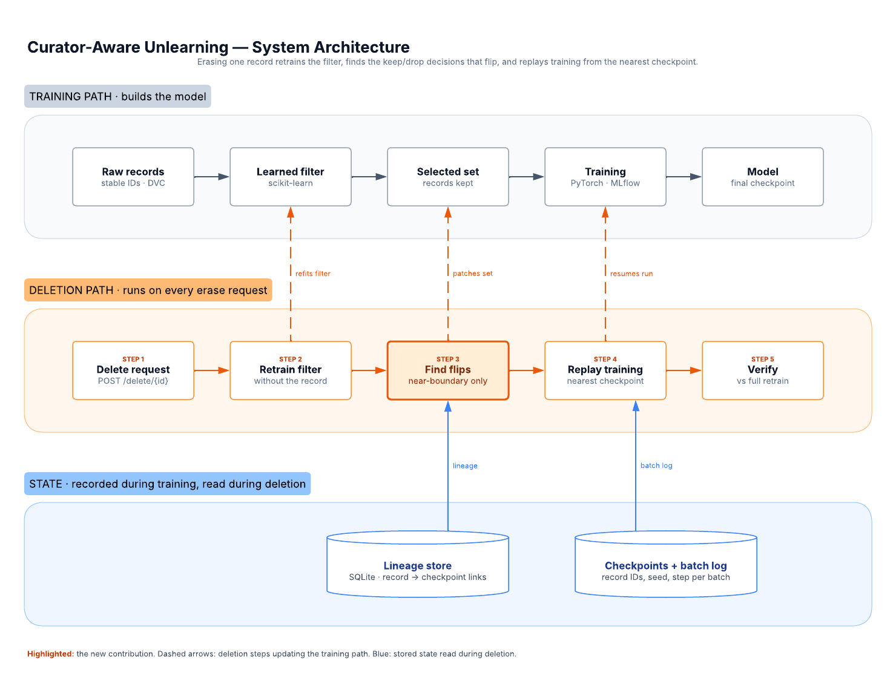

# Curator-Aware Unlearning (delta-cure)

[](https://github.com/IshritRai/delta-cure/actions/workflows/ci.yml)

A deletion service for ML training pipelines. Many pipelines use a **learned filter** (a quality
classifier) to decide which records reach the model. When a record is deleted, today's tools
remove it from the model's training set and stop there, but that record also trained the
filter. Without it, the filter's keep/drop decisions can flip: some kept records should now
drop, and some rejected records should now get in. This service finds those flips and updates
the model to match a from-scratch retrain, at lower cost, without retraining from scratch.

## Architecture



Each deletion step updates the training step above it. The highlighted step is the new part:
only records near the filter's boundary are re-scored. A lineage store records which checkpoint
first used each record, so replay starts as late as possible. See
[`docs/design.md`](docs/design.md) for the data flow, stored state and deletion steps.

## Components and stack

| Layer | Scope | Tools |
| --- | --- | --- |
| Data versioning | Raw records with stable IDs; versioned snapshots per deletion | DVC, Hugging Face `datasets` |
| Learned filter | Quality classifier trained on a labelled slice; stores each record's margin | scikit-learn `LogisticRegression` |
| Training | Small text classifier; checkpoints every N steps; per-batch log of record IDs, seed and step | PyTorch, MLflow |
| Lineage store | Record → filter → selected set → checkpoint links | SQLite |
| Deletion engine | Retrain filter, re-score near-boundary records, compute flips, replay from nearest checkpoint | Python package |
| API | `POST /delete/{record_id}`, `GET /status/{job_id}`, `GET /lineage/{record_id}` | FastAPI |
| Verification | Compares output with a full re-filter + retrain on small runs | pytest, GitHub Actions |
| Packaging | One-command demo and README with measured results | Docker Compose |

## Milestones

- [ ] **1. Baseline pipeline** — dataset with stable IDs, filter, training loop with checkpoints and batch log, MLflow tracking. One command trains end to end.
- [ ] **2. Reference path** — naive deletion (drop the record only) and full re-filter + retrain; their gap is measured.
- [ ] **3. Flip engine** — retrain filter, re-score records within a margin band, compute dropped and admitted sets; tests show no missed flips against full re-filtering.
- [ ] **4. Replay engine** — resume from the earliest checkpoint touched by any flipped or deleted record, using the batch log; result matches full retrain on small runs.
- [ ] **5. Service** — FastAPI endpoints, lineage store, job status; deletion works through the API.
- [ ] **6. Benchmark and polish** — random and adversarial deletion sequences, cost comparison, Docker Compose, README with results.

## Setup

Requires Python 3.11.

```bash
git clone https://github.com/IshritRai/delta-cure.git
cd delta-cure
python3.11 -m venv .venv
source .venv/bin/activate
pip install -e ".[dev]"
pre-commit install
```

## Run

The pipeline, deletion engine and API are not implemented yet; run commands will be added as
each milestone lands. To run the checks:

```bash
ruff check . && ruff format --check .
mypy
pytest
```

## Results

Results: to be added from our own runs.

## Contributing

See [CONTRIBUTING.md](CONTRIBUTING.md).

## License

[MIT](LICENSE)
