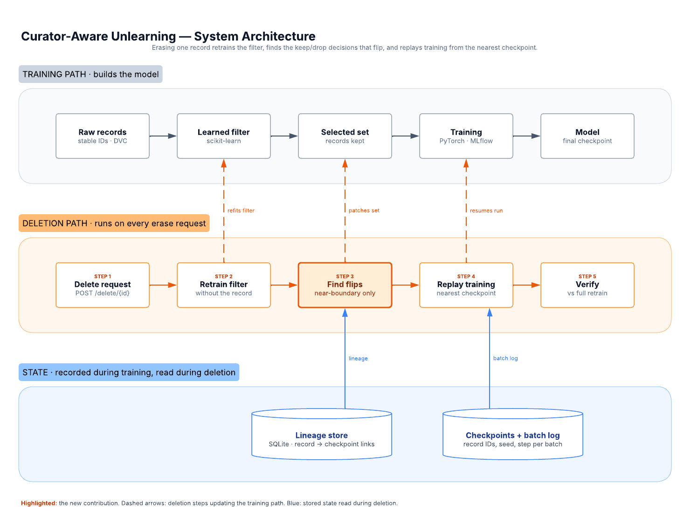

# Curator-Aware Unlearning — Engineering Scope

A deletion service for ML training pipelines. When someone asks for their data to be erased, it updates every part of the pipeline that data touched, including a learned filter's picks, without retraining from scratch.

Product requirements: [`prd.md`](prd.md). Design: [`design.md`](design.md). Decisions: [`decisions/`](decisions/README.md).

## Problem

Many pipelines use a **learned filter** (a quality classifier) to decide which records reach the model. When a record is deleted, today's tools remove it from the model's training set and stop there.

But if that record was in the filter's labelled training slice, it also trained the filter. Without it, the filter's keep/drop decisions can flip: some kept records should now drop, and some rejected records should now get in. This service finds those flips and updates the model to match a from-scratch retrain, at lower cost.

A record that was only scored by the filter, not used to train it, cannot cause flips; deleting it needs no filter work ([ADR 0002](decisions/0002-two-deletion-cases.md)).

## Architecture

Each deletion step updates the training step above it. The highlighted step is the new part: only records near the filter's boundary are re-scored, and "near" is a certified band computed from how far the filter's weights moved, so no flip can be missed ([ADR 0003](decisions/0003-certified-flip-band.md)). Training data is ordered by a per-record hash so a deletion changes as few batches as possible ([ADR 0004](decisions/0004-deterministic-record-ordering.md)). A lineage store records which checkpoint first used each record, so replay starts as late as possible.

## Components and stack

Every layer uses standard, widely used tools, so the novel part (flip handling) stands out.

| Layer | Scope | Tools |
| --- | --- | --- |
| Data versioning | Raw records with stable IDs; a dataset version per deletion as a manifest of record IDs, with physical deletion of erased records ([ADR 0007](decisions/0007-erasure-of-derived-artifacts.md)) | Hugging Face `datasets`; DVC under review in ADR 0007 |
| Learned filter | Quality classifier trained on a labelled slice; data-independent features; fixed score threshold; stores each record's score and feature norm | scikit-learn `LogisticRegression` |
| Training | Small text classifier; hash-based record order; checkpoints every N steps with optimizer and scheduler state; per-batch log of record IDs, seed and step | PyTorch, MLflow |
| Lineage store | Record → filter → selected set → checkpoint links; labelled-slice membership; deletion tombstones | SQLite |
| Deletion engine | Classify the deletion, retrain filter, re-score the certified band, compute flips, replay from nearest checkpoint, purge superseded artifacts | Python package |
| API | `POST /delete/{record_id}`, `GET /status/{job_id}`, `GET /lineage/{record_id}`; deletions processed in batches ([ADR 0008](decisions/0008-batched-deletions.md)) | FastAPI |
| Verification | Compares output with a full re-filter + retrain on small runs | pytest, GitHub Actions |
| Packaging | One-command demo and README with measured results | Docker Compose |

## Milestones

Each milestone ends with something runnable.

1. **Baseline pipeline.** Dataset with stable IDs, filter with data-independent features, training loop with hash-based ordering, complete checkpoints and batch log, MLflow tracking. Settles the training schedule ([ADR 0006](decisions/0006-training-schedule-for-replay-savings.md)) and storage approach (ADR 0007). Deliverable: one command trains end to end.
2. **Reference path.** Naive deletion (drop the record only) and full re-filter + retrain. Deliverable: both paths run and their gap is measured.
3. **Flip engine.** Retrain filter, re-score records within the certified band, compute dropped and admitted sets. Deliverable: tests show no missed flips against full re-filtering, including adversarial deletions.
4. **Replay engine.** Resume from the earliest checkpoint whose batches change because of any flipped or deleted record, using the batch log. Deliverable: result is bit-identical to a full retrain on small CPU runs ([ADR 0005](decisions/0005-checkpoint-contents-and-determinism.md)).
5. **Service.** FastAPI endpoints, lineage store, batched deletion jobs, job status, purge of superseded artifacts. Deliverable: deletion works through the API.
6. **Benchmark and polish.** Random and adversarial deletion sequences, single and batched, reported per deletion case; cost comparison, Docker Compose, README with results. Deliverable: public repo.

## Success checks

The project succeeds when deletions through the service match a full retrain at lower cost. All numbers come from measured runs; none are targets set in advance.

| Check | How it's measured | Pass | Fail |
| --- | --- | --- | --- |
| No missed flips | Flip set vs full re-filter, every deletion | Identical sets | Any mismatch |
| Same training set | Curated set after deletion vs fresh curation | Identical | Any mismatch |
| Replay exact | Replay vs full retrain, small CPU runs, same ordering and schedule | Bit-identical parameters | Any difference |
| Model match | Accuracy gap vs full retrain, across seeds | Within seed-to-seed variation | Outside it |
| Cost saved | Wall-clock and GPU time vs full retrain | Lower, reported per deletion | Equal or higher |
| Naive gap shown | Error of drop-only deletion vs full retrain | Measurably worse than this service | No difference |
| Erasure complete | Search all stores after a deletion for the record or artifacts trained on it | None found | Any found |
| Reproducible | Fresh clone runs demo with one command | Works | Fails |

## Sources

- [Exact Unlearning After Data Curation (Oct 2026)](https://arxiv.org/abs/2610.33426): closest prior work; fixed filter only
- [Schelter, unlearning via incremental view maintenance (2021)](https://ssc.io/pdf/ivm-unlearning.pdf): deterministic pipelines only
- [Unlearning at Scale](https://arxiv.org/html/2508.12220v1): per-batch logging and checkpoint replay for one model
- [SISA, Machine Unlearning (IEEE S&P 2021)](https://arxiv.org/pdf/1912.03817): checkpoint-based exact unlearning
- [Do unlearning algorithms learn the right features? (Nov 2026)](https://arxiv.org/abs/2611.06681): small deletions can change what retraining learns
